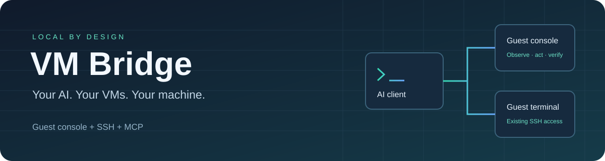

# VM Bridge

[English documentation](README.md) · [Installatie](docs/getting-started.md) · [MCP en AI-programma's](docs/ai-clients.md)



Geef je AI toegang tot het **eigen scherm, toetsenbord en de muis van een VMware-VM**, naast bestaande SSH-toegang. Je kunt intussen op je host verder werken. VM Bridge stuurt invoer naar de gastconsole en gebruikt geen hostmuis- of hosttoetsenbordbediening.

VM Bridge 0.4 is een publieke bètaversie voor **Windows 10/11, VMware Workstation en Python 3.13**. Linux-/macOS-hosts en andere hypervisors zijn nog niet ondersteund. Niet ieder AI-programma ondersteunt lokale MCP-servers; een AI met terminaltoegang kan de CLI gebruiken.

## Aan de slag

Installeer [uv](https://docs.astral.sh/uv/getting-started/installation/) en Git. Open PowerShell 7:

```powershell
git clone https://github.com/moravi1233-ops/vm-bridge.git
cd vm-bridge
pwsh -File .\Install.ps1
```

De installatie maakt een eigen omgeving onder `%USERPROFILE%\AppData\Local\VMBridge`. Bestaande VM's blijven draaien. Er wordt geen service of opstarttaak aangemaakt. Het procesbeheer is ingebouwd; Codex is geen vereiste.

Voor Codex of een andere AI die skills kan lezen, kun je daarnaast de skill installeren:

```powershell
pwsh -File .\Install.ps1 -InstallSkill
```

Kies één installatievariant. Bij een bestaande installatie voeg je `-Update` toe; er moet dan een nieuwe pakketversie beschikbaar zijn. Kopieer de inhoud van het gegenereerde `mcp-config.json` naar de MCP-instellingen van je lokale AI-programma. Je AI gebruikt één unieke sessie-UUID per gesprek. De [handleiding](docs/ai-clients.md) legt dit uit.

Geef je AI vervolgens bijvoorbeeld deze opdracht:

> Lees de VM Bridge-handleiding en ontdek mijn VM's. Verbind alleen met de bedoelde gast. Laat mijn hostwerk en andere VM's draaien, controleer de resultaten en sluit je tijdelijke helpers na afloop.

Een VM heeft een geconfigureerde console en/of SSH-verbinding nodig. De installatie maakt die toegang niet automatisch. De tool kan een wijzigingsplan voor een gestopte VM voorbereiden en toepassen; hij sluit een actieve VM daarvoor niet af.

## Wat je krijgt

- Scherpe, verse beelden op oorspronkelijke resolutie en gerichte bediening in de gast.
- Bestaande SSH-profielen met controle van hostsleutels.
- Een tijdelijke live viewer, standaard alleen om mee te kijken.
- Korte hervatpunten, gecontroleerde uitkomsten en voorlopige ervaringen.
- Updates van herbruikbare procedures die pas na een expliciete opdracht actief worden.
- Tijdelijke workers die verdwijnen bij afsluiten, inactiviteit of het verdwijnen van hun eigenaar.

Afbeeldingen die je AI al heeft ontvangen kan VM Bridge niet uit diens chatgeheugen wissen. Een verzonden klik bewijst geen geslaagde taak. De ingebouwde ervaring is extern geheugen, geen training van AI-modelgewichten. Lees [architectuur en grenzen](docs/architecture.md) voor wat wel en niet gemeten is.

## Privacy en updates

VM-inventaris, instellingen, wachtwoorden, screenshots en gebruiksgeheugen blijven standaard buiten de broncode en onder je eigen Windows-account. Inhoud die je AI ontvangt valt ook onder de gegevensverwerking van dat AI-programma. Er is geen extra AI-account of API-sleutel nodig voor VM Bridge zelf.

Deze repository bevat broncode, fictieve tests en documentatie. Publiceren verloopt via tests en een controle op onbedoelde bestanden en gegevens. Er draait geen achtergrondprogramma dat je werkmap uploadt. Zie [privacy](docs/privacy.md) en [releaseproces](docs/releases.md).

Originele code: MIT. Gebundelde noVNC en afhankelijkheden behouden hun eigen licenties; zie [THIRD_PARTY_NOTICES.md](THIRD_PARTY_NOTICES.md).
