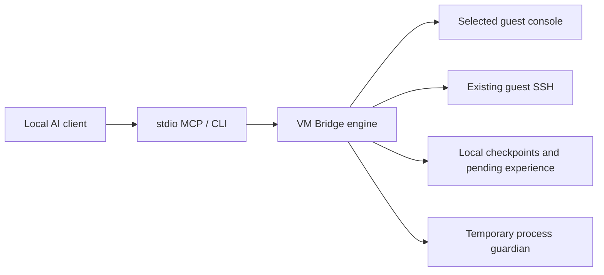

<p align="center"></p>

<p align="center">
  <a href="https://github.com/moravi1233-ops/vm-bridge/actions/workflows/ci.yml"></a>
  <a href="https://github.com/moravi1233-ops/vm-bridge/releases"></a>
  
  
  <a href="LICENSE"></a>
</p>

<p align="center"><strong>Let your AI work inside a virtual machine while you keep using your host.</strong><br>Native guest screenshots, mouse and keyboard control, existing SSH access, and a local MCP server.</p>

<p align="center"><a href="docs/getting-started.md">Get started</a> · <a href="docs/ai-clients.md">Connect your AI</a> · <a href="README.NL.md">Nederlands</a> · <a href="docs/architecture.md">Architecture</a> · <a href="docs/privacy.md">Privacy</a></p>

## What is VM Bridge?

VM Bridge connects an AI assistant to a **VMware guest's own console and terminal**. Console input goes to the selected guest, without moving your host cursor or taking over your host desktop. Your assistant can inspect a fresh screenshot, perform an action, and check the result. A temporary browser viewer lets you watch along.

Use it to install software, configure desktop applications, troubleshoot systems, or carry out repeatable VM work. Current and future VMs can be discovered through VMware inventory and explicitly registered folders.

**Public beta · Windows hosts · VMware Workstation.** Other hypervisors and Linux/macOS hosts are not implemented. A compatible local MCP client or an assistant with local terminal access is required. Installing this repository alone does not connect a web-only AI chat to your computer.

## Why use it?

| Capability | What it provides |
| --- | --- |
| Guest-bound control | Mouse and keyboard input to one leased VM console; no host input APIs |
| Clear observations | Fresh PNGs at native resolution, with optional crops and acknowledged identical-image comparison |
| Existing terminal access | Native OpenSSH with strict host-key checking and bounded output |
| Live viewing | Temporary localhost noVNC viewer, read-only by default; explicit human takeover |
| Useful task memory | Concise resume points, explicitly checked outcomes, and pending factual experiences |
| Reviewed improvements | Candidate procedures stay inactive until a human-authorized reviewed update |
| On-demand lifecycle | Temporary workers with idle limits and Windows Job Object cleanup; no resident service |
| Local integration | CLI and stdio MCP adapter use the same engine; no extra AI API key required |

A screenshot is an observation, not a video feed into the model. A sent click is not proof of task success. Your assistant still needs to inspect and reason about the result.

## Quick start

**Requirements:** Windows 10/11, PowerShell 7, Git, [uv](https://docs.astral.sh/uv/getting-started/installation/), and VMware Workstation. The installer resolves Python 3.13 and locked dependencies. Administrator access is not normally required for a user installation.

```powershell
git clone https://github.com/moravi1233-ops/vm-bridge.git
cd vm-bridge
pwsh -File .\Install.ps1
```

To install the optional Codex skill as well, use `-InstallSkill` on that installation command. A custom skill destination can be supplied with `-SkillDirectory`. Codex and an external process-manager skill are **not required** for a standalone installation.

The installer creates an isolated version under `%USERPROFILE%\AppData\Local\VMBridge`, a small launcher, and local MCP configuration examples. It does not start VMs, install a service, change your system PATH, enable an MCP server, or install software in a guest.

### Connect a local MCP client

Merge the generated `%USERPROFILE%\AppData\Local\VMBridge\mcp-config.json` into your client's MCP configuration. This contains the correct paths for **your own PC**. Restart only that client connection if it needs to reload its configuration.

Ask your assistant:

> Read the VM Bridge instructions. Discover my VMs, select the intended guest, and use its console or existing SSH profile. Preserve my host work and other VMs. Observe before acting, verify meaningful results, and close temporary helpers when finished.

Each conversation uses a stable UUID as `owner_thread_id`. Codex can use its actual thread UUID; other clients can generate a conversation UUID or call `vm_new_context`. The MCP process automatically owns its temporary workers. See [AI client integration](docs/ai-clients.md).

### Use the CLI

From a persistent PowerShell terminal:

```powershell
$env:VMBRIDGE_OWNER = [guid]::NewGuid().ToString()
$env:VMBRIDGE_OWNER_PID = "$PID"
$bridge = Join-Path $env:USERPROFILE 'AppData\Local\VMBridge\vmbridge.ps1'
& $bridge discover
```

A guest needs a configured localhost console and/or an existing SSH profile. A console change can be prepared and reviewed while a VM is running, but applied only while it is stopped. VM Bridge never stops an active VM to finish setup. See [the full setup guide](docs/getting-started.md).

## How it works



The bundled guardian monitors a stable owning process and contains only application-owned helpers in a Windows Job Object. It ends the helper tree when its owner exits. Explicit disconnect and idle limits also close workers. In an existing Codex installation, VM Bridge can reuse its registered process-lifecycle skill. No host application or VM is placed in a helper job.

## Memory that stays under your control

`review` combines observed outcome checks, a short resume point, and a pending factual experience. Lightweight diagnostic checks can collect deduplicated improvement ideas at normal shutdown. These checks do not infer successful GUI workflows. The assistant must supply semantic notes based on what it actually observed.

Pending ideas cannot execute procedures or rewrite code, skills, permissions, or startup settings. Procedure activation requires a concrete reviewed proposal and explicit human authorization. This is external task memory, not model-weight training. VM Bridge cannot erase screenshots already delivered to an AI conversation or guarantee unlimited model context.

Temporary screenshots rotate and are cleaned on close or later recovery. Explicit evidence images are stored separately and are not automatically deleted. See [architecture](docs/architecture.md) and [privacy](docs/privacy.md).

## Development and updates

```powershell
uv sync --locked --python 3.13
uv run --locked pytest -q
uv run --locked python scripts/check_publication.py
```

Tests use synthetic localhost consoles and SSH fixtures; they do not need input in a real VM or your host desktop. Bundled lifecycle tests exercise owner-exit cleanup. Windows CI runs tests, privacy checks and package builds.

Maintainers publish reviewed changes through `Publish.ps1`, which runs checks before a normal fast-forward push. A version tag triggers the release workflow, which tests and builds the release before publishing assets. There is no background uploader or automatic push of arbitrary local files. See [contributing](CONTRIBUTING.md), [releases](docs/releases.md), and [changelog](CHANGELOG.md).

## Current boundaries

- Windows host and VMware Workstation are the implemented platform/provider.
- Guest mouse support depends on suitable VMware Tools or pointing drivers. A visible screen does not prove that mouse input works.
- VNC endpoints must be local; do not expose them publicly. Remote access needs an independently secured tunnel.
- SSH timeouts leave the remote command's outcome uncertain; inspect before retrying.
- Conversation ownership coordinates clients in one Windows account; it is not a sandbox against another program running as that user.
- No universal FPS or end-to-end AI response-time guarantee is claimed. Local capture and payload measurements exclude model reasoning.
- Support for a client's configuration format does not mean every AI product/version has been tested.

## License and acknowledgements

Original VM Bridge code is [MIT licensed](LICENSE). Bundled **noVNC 1.7.0** and dependencies retain their own licenses, including MPL-2.0 and other terms described in [THIRD_PARTY_NOTICES.md](THIRD_PARTY_NOTICES.md). This repository preserves their source and license notices. It is an independent project and is not affiliated with VMware, OpenAI, or noVNC.

Questions or reproducible bugs? [Open an issue](https://github.com/moravi1233-ops/vm-bridge/issues). Remove private paths, credentials, screenshots and VM inventory before posting diagnostics.
